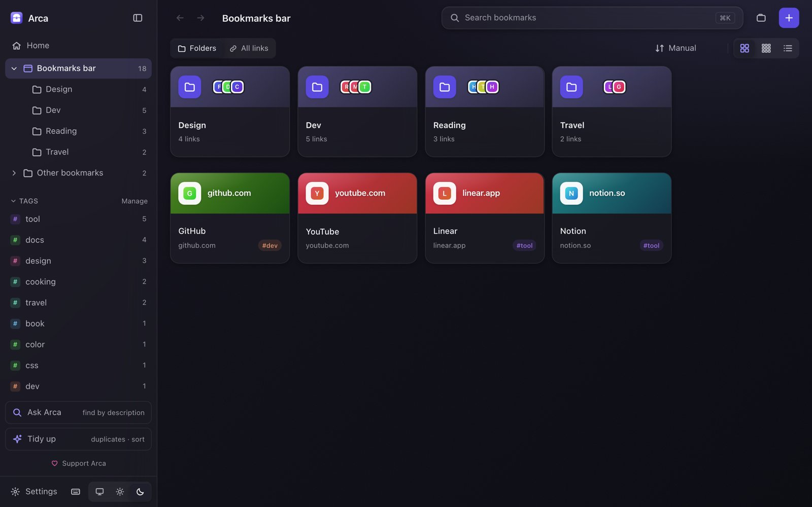
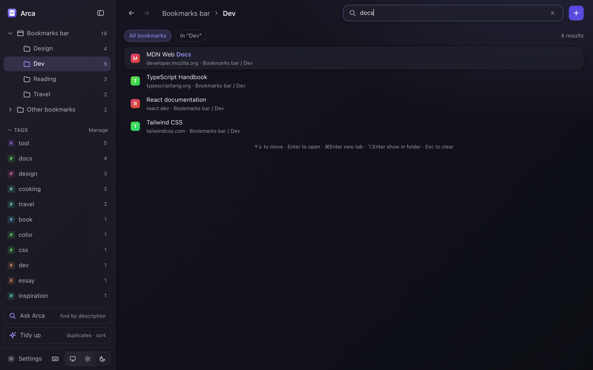
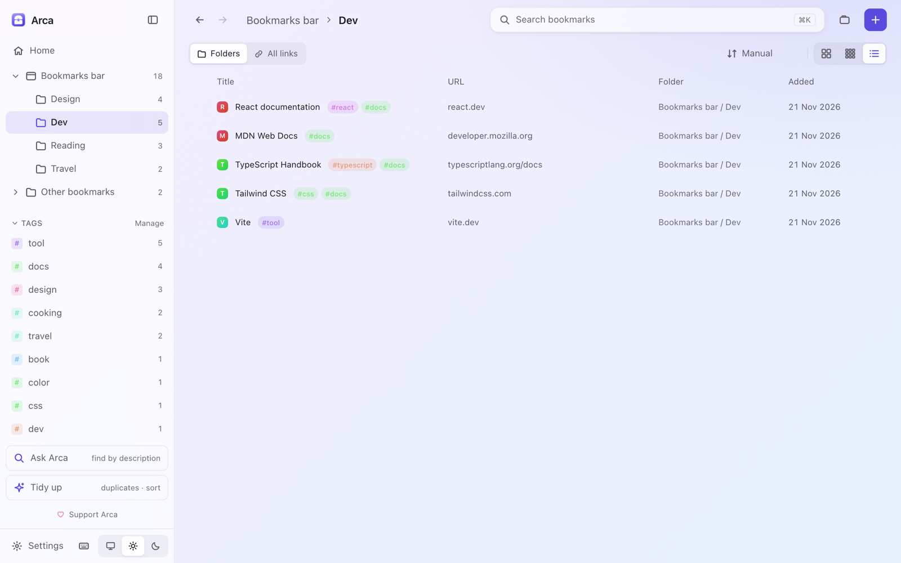
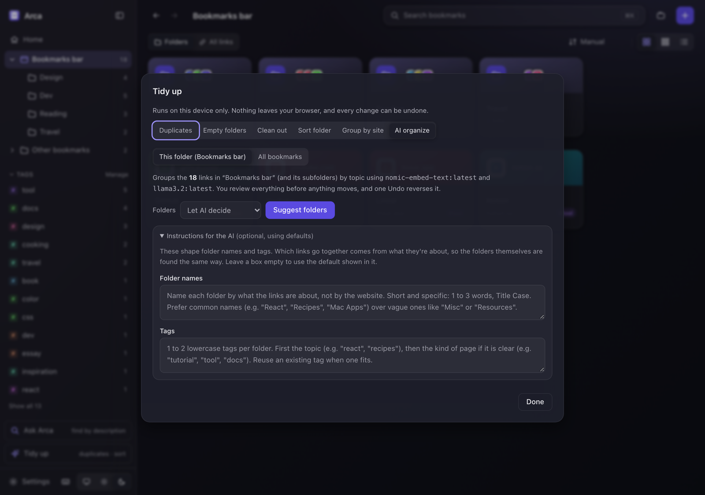

# Arca

**Your real browser bookmarks as a fast, visual dashboard, with optional local AI
to organize and find them.**

Arca is a Manifest V3 extension for Chromium browsers (Chrome, Brave, Edge, Arc, Dia,
Ardia). It turns your bookmarks into an editable dashboard on the New Tab page. Every
change in Arca is a real bookmark change, so your browser's sync, other devices and
other tools all stay in step. Nothing is uploaded anywhere: no accounts, no analytics,
no servers.

> _Arca_ (Latin): a chest where valuables were kept.



| Search                                 | List view with tags (light theme)             |
| -------------------------------------- | --------------------------------------------- |
|  |  |

## Features

**Browse and edit**

- Sidebar folder tree, folder cards and bookmark tiles with brand-coloured covers,
  small tiles, or a sortable list. Breadcrumbs, back/forward.
- **All links** view: every link inside a folder and its subfolders in one grid.
- Add, edit, rename (F2), delete, all undoable (⌘Z or the toast's Undo).
- **Drag & drop**: reorder, or drop onto a folder card, a sidebar folder or a
  breadcrumb to move. Works from the keyboard too (Space, arrows, Space).
- **Multi-select**: tick items (⇧-click for a range, ⌘A for all) to move, tag, open,
  ungroup or delete them together.
- **Tags** on bookmarks and folders, with colours, a tag manager (rename, merge,
  delete) and `#tag` search.

**Find**

- **Search** (⌘K or `/`): fuzzy over titles, addresses and folders, under 50 ms with
  5,000 bookmarks. Copies of the same page fold into one result.
- **Link previews** (opt-in): hover for a card with the page's excerpt and headings.
- **Ask Arca** (local AI): describe a bookmark you half remember ("that Mac app for
  downloading videos") and Arca finds it, with follow-up questions.
- **Related by meaning** (local AI): search results include pages that match what
  you mean, not just the words you typed.

**Tidy up**

- Remove duplicates (keeps the best copy) and empty folders, sort a folder for real,
  group links into per-site folders.
- **Broken links** (opt-in): find dead or moved links, then fix or remove them.
- **Clean out**: finds impulse saves (old searches, local addresses, one-time pages)
  to archive or delete.
- **AI organize** (local AI): groups links by topic, names the folders and suggests
  tags, following your own rules if you write any. You review everything before
  anything moves, and one Undo reverses it. Works on one folder or all your bookmarks.

**Everywhere else**

- **Popup** (⌥⇧B): quick search, bookmark this tab, most visited, recently added.
- **Right-click → Add to Arca…** on any page or link, with folder and tags.
- **Mini windows**: open a link in a small peek window, then move it into your main
  window with one click.
- **Import and export**: HTML (any browser) and an Arca JSON backup with tags.
- Dark-first design with System / Light / Dark themes; motion respects "Reduce motion".

## Install

Arca isn't in a web store yet. Build it and load it unpacked; it takes about two
minutes.

1. Install [bun](https://bun.sh) (or use Node 20+ with pnpm), then:

   ```bash
   git clone https://github.com/<your-account>/arca.git
   cd arca
   bun install
   bun run build
   ```

   The extension is written to `.output/chrome-mv3`.

2. Open your browser's extensions page: `chrome://extensions` (Edge:
   `edge://extensions`, Brave: `brave://extensions`).
3. Turn on **Developer mode**, click **Load unpacked** and choose
   `.output/chrome-mv3`.
4. Open a new tab. Chrome asks whether to keep the New Tab change: choose **Keep it**.
5. Optional: pin Arca from the puzzle-piece menu so the popup is one click away.

After pulling updates, run `bun run build` again and click the reload icon on Arca's
card in the extensions page.

**Arc, Dia and Ardia**: these browsers open their own command bar on ⌘T instead of
a New Tab page. Open Arca from the toolbar icon or the popup (⌥⇧B), or type "Arca" in
the command bar, and keep that tab pinned. Arca's own Settings also offer a minimal
search page or a redirect as the New Tab.

## Local AI setup (optional)

The AI features run on **your own computer** with [Ollama](https://ollama.com). No
API keys, no cloud, no Docker. Arca only ever talks to `localhost`, and it rejects any
other address even if one is typed in.

**What runs where**

- An **embedding model** turns each bookmark's title and site into numbers. Arca
  groups and searches those itself and caches them in the browser, so only new or
  edited bookmarks are read again.
- A small **chat model** names folders, suggests tags and answers Ask Arca. It only
  sees short lists of titles and sites, and it can only pick from your real bookmarks.

### 1. Install Ollama and pull two models

Download Ollama from [ollama.com/download](https://ollama.com/download), start it,
then in a terminal:

```bash
ollama pull nomic-embed-text   # embeddings: fast (~10 ms per bookmark)
ollama pull llama3.2           # chat: folder names, tags, Ask Arca (2 GB)
```

Other good choices: `qwen3-embedding:4b` groups more accurately but is about 9× slower
on the first read; `phi3` or `gemma2:2b` as smaller chat models. Any Ollama embedding
and chat model works.

### 2. Let Arca talk to Ollama

Ollama blocks browser extensions by default. Allow Arca by its extension ID, which
is shown on its card in `chrome://extensions`. If Ollama refuses, Arca's Settings →
Local AI shows the exact command with your ID filled in, ready to copy.

**macOS** (Ollama app):

```bash
launchctl setenv OLLAMA_ORIGINS "chrome-extension://YOUR_ARCA_ID"
```

Then quit Ollama from the menu bar and open it again. This resets when the Mac
restarts; run it again if Arca says Ollama refused the request.

**Windows**: run this in PowerShell, then quit Ollama from the tray and start it again:

```powershell
setx OLLAMA_ORIGINS "chrome-extension://YOUR_ARCA_ID"
```

**Linux** (systemd service): run `sudo systemctl edit ollama.service`, add the lines
below, then run `sudo systemctl restart ollama`.

```ini
[Service]
Environment="OLLAMA_ORIGINS=chrome-extension://YOUR_ARCA_ID"
```

**Running `ollama serve` yourself:**

```bash
OLLAMA_ORIGINS="chrome-extension://YOUR_ARCA_ID" ollama serve
```

### 3. Turn it on in Arca

Settings → **Local AI** → turn it on. The browser asks to let Arca reach
`localhost:11434`; allow it. Pick your embedding and chat models, then click **Test
connection**.

### 4. Use it

- **AI organize**: open a folder → **Tidy up** → **AI organize** → **Suggest
  folders**. Choose "This folder" or "All bookmarks", and let the AI decide how many
  folders or pick a number. Open **Instructions for the AI** to set your own rules
  for folder names and tags (for example "Use one word per folder" or "Always add a
  tag for the year"). Rename, untick or edit tags in the review, then **Apply**.
- **Ask Arca**: click **Ask Arca** in the sidebar and describe what you're looking
  for. The first question reads your bookmarks once (a minute or two for a few
  thousand); after that, answers take a few seconds.
- **List descriptions**: switch to list view to see a one-line summary under each
  title (can be turned off in Settings).



**Troubleshooting**

| Arca says                  | Do this                                                             |
| -------------------------- | ------------------------------------------------------------------- |
| Can't reach Ollama         | Start the Ollama app (or `ollama serve`).                           |
| Ollama refused the request | Set `OLLAMA_ORIGINS` as in step 2, then restart Ollama.             |
| Model not found            | `ollama pull <model>`, or pick an installed model in Settings.      |
| First run is slow          | Normal: every bookmark is read once. Later runs only read new ones. |

## Privacy and security

- Bookmarks stay in your browser. Arca makes **no network requests** unless you turn
  on link previews or the broken-link check (both ask for permission first) or local
  AI (which only reaches Ollama on `localhost`).
- No analytics, no accounts, no remote code; a strict Content Security Policy blocks
  inline and remote scripts.
- Links that can run code (`javascript:`, `data:`) are never opened or rendered as
  links.
- Other extensions and websites can't message, frame or read Arca.

Details and the threat model: [SECURITY.md](SECURITY.md).

## Keyboard shortcuts

Press `?` in the dashboard for the full list. Highlights: ⌘K search, `[` / `]`
back/forward, ⌥↑ parent folder, F2 rename, ⌘⌫ delete, ⌘Z undo, ⌘\ sidebar, ⌥⇧B popup.

## Development

```bash
bun run dev        # dev build with hot reload in a Chromium window
bun run build      # production build in .output/chrome-mv3
bun run zip        # packaged zip for a store upload
bun run test       # unit and component tests (Vitest, fake browser APIs)
bun run lint       # ESLint, including security rules
bun run typecheck  # TypeScript
bun run security   # static checks on the built manifest, CSP and bundle
bun run e2e        # real-Chrome checks (after a build): speed, editing, security
bun run e2e:ai     # adds checks against real Ollama models (optional)
```

Commits are checked by git hooks installed with `bun install`: Prettier and ESLint on
staged files, and [commitlint](https://commitlint.js.org) for the message format.

Stack: [WXT](https://wxt.dev), React 19, TypeScript, Tailwind CSS 4, Zustand, dnd-kit,
TanStack Virtual. `bun run e2e` loads the built extension into headless Chrome with a
throwaway profile; set `CHROME_PATH` to use another Chromium binary. To refresh the
screenshots above, run `bun run build && bun scripts/screenshots.ts`.

Project docs: [CHANGELOG.md](CHANGELOG.md), [BACKLOG.md](BACKLOG.md), the product spec
[arca-prd.md](arca-prd.md), and git conventions in [docs/git/](docs/git/).

## Contributing

Issues and pull requests are welcome. Please run `bun run lint`, `bun run typecheck`,
`bun run test`, `bun run build`, `bun run security` and `bun run e2e` before opening a
pull request, and follow the commit style in [docs/git/](docs/git/).

## License

[MIT](LICENSE) © 2026 Ateeb Asif. Free to use, modify and share.
